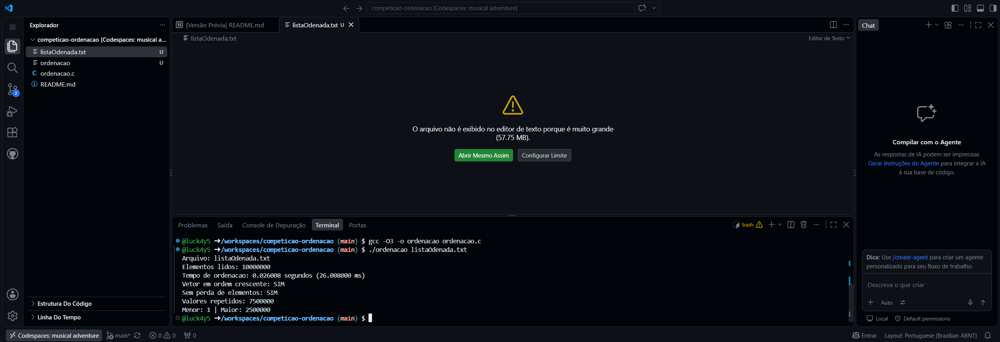

# Competição de Ordenação: O Desafio dos Milissegundos

Trabalho da disciplina **Estrutura de Dados**: ordenar a base `ListahAhSerOrdenada.txt` (~60 MB) no menor tempo de CPU possível, em C.

## Equipe
1. Lucas Otávio de Oliveira Andrade (líder)
2. Vinicius Baldo da Silva
3. Renan Cardoso
4. Luis Miguel

## Análise da base
- **10.000.000** de números inteiros, um por linha
- Valores entre **1 e 2.500.000**
- **7.500.000 repetições** (os valores 1, 2 e 3 aparecem ~833 mil vezes cada)

Como a faixa de valores (2,5 milhões) é **menor** que a quantidade de elementos (10 milhões), o algoritmo ideal é o **Counting Sort**.

## Algoritmo escolhido: híbrido Counting Sort + Radix Sort

O programa olha o menor e o maior valor e escolhe sozinho:

1. **Counting Sort** (usado na base da competição): cria um vetor de contadores com uma posição para cada valor possível, conta quantas vezes cada número aparece e depois reescreve o vetor em ordem. Faz só **2 varreduras** e nenhuma comparação.
2. **Radix Sort LSD** (reserva para faixas grandes): distribui os números em baldes, 11 bits por vez, do menos para o mais significativo.

| Algoritmo | Complexidade | Na base da competição |
|---|---|---|
| Quick Sort | O(N log N) médio, O(N²) pior caso | Sofre com milhões de valores repetidos |
| Merge Sort | O(N log N) sempre | ~23 níveis de divisão para 10 milhões |
| Radix Sort | O(N · k) | ~700 ms (2 passadas) |
| **Counting Sort (usado)** | **O(N + faixa)** | **~27 ms** |

### Otimizações aplicadas
- **Escolha automática do algoritmo** pela faixa dos dados (`max - min`).
- **Base 2¹¹ (2048 baldes):** cada passada processa 11 bits, então números de até ~8,5 bilhões precisam de só 3 passadas.
- **Número de passadas calculado pela faixa dos dados** (`max - min`): se os valores forem menores, faz menos passadas.
- **Deslocamento pelo mínimo:** subtrai o menor valor de todos, o que permite ordenar números negativos também.
- **Histograma único:** uma só leitura do vetor monta as contagens de todas as passadas.
- **Leitura do arquivo de uma vez** com `fread` e conversão manual (mais rápida que `fscanf`) — fora da medição.
- **Memória:** todo `malloc` tem seu `free` correspondente.

## Medição de tempo
Somente a chamada `ordenarVetor()` fica entre os dois `clock()`. A leitura do disco e a conversão do texto acontecem antes, e a verificação acontece depois, então nada disso entra no tempo.

```c
clock_t inicio = clock();
ordenarVetor(vetor, n);
clock_t fim = clock();
```

## Verificação de corretude
Depois de ordenar, o programa confere:
- se cada elemento é **menor ou igual** ao seguinte (ordem crescente);
- se a **soma de controle** de todos os elementos é a mesma de antes (nenhum elemento perdido ou alterado).

## Como compilar e executar

Coloque o arquivo `ListahAhSerOrdenada.txt` na mesma pasta do código. Os números podem estar separados por quebra de linha, espaço ou vírgula.

**Linux / macOS / WSL:**
```bash
gcc -O3 -march=native -o ordenacao ordenacao.c
./ordenacao ListahAhSerOrdenada.txt
```

**Windows (MinGW / Code::Blocks / Dev-C++):**
```bash
gcc -O3 -o ordenacao.exe ordenacao.c
ordenacao.exe ListahAhSerOrdenada.txt
```

Para salvar a lista ordenada em `ListaOrdenada.txt`:
```bash
./ordenacao ListahAhSerOrdenada.txt --salvar
```

## Resultado

```
Arquivo: ListahAhSerOrdenada.txt
Elementos lidos: 10000000
Tempo de ordenacao: 0.027706 segundos (27.706000 ms)
Vetor em ordem crescente: SIM
Sem perda de elementos: SIM
Valores repetidos: 7500000
Menor: 1 | Maior: 2500000
```


